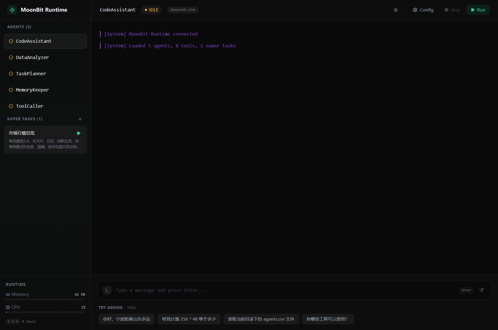
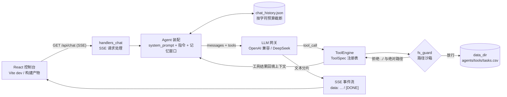

# MoonBit AI Agent Runtime

**用 MoonBit 原生实现的轻量 AI Agent 运行时：CSV 定义 Agent、可插拔工具 + 原生 function calling 回环、文件工具全程沙箱，自带一个能直接对话的 React 控制台。**

[](https://mooncakes.io/docs/poipoiiii/agent-runtime)
[](https://mooncakes.io/docs/poipoiiii/agent-runtime)
[](./LICENSE)
[](./.github/workflows/check.yml)



<sub>控制台界面：左侧是 `agents.csv` 里的 5 个 Agent、超级任务与运行时内存/CPU 监控，右侧是 SSE 对话终端。</sub>

## 30 秒看懂

| 你想要 | 这个仓库给你 |
|---|---|
| 在 MoonBit 里接 LLM 并跑通 function calling | `lib/llm.mbt` + `lib/tool_spec.mbt`：OpenAI 兼容请求、tool_call 解析、结果回填的完整回环 |
| 让模型安全地读写本地文件 | `lib/fs_guard.mbt`：拒绝绝对路径 / 盘符 / `~` / `../`，所有文件工具锁在 `data_dir` 内 |
| 加一个自己的工具 | 实现一个 `ToolSpec` 注册进 `ToolEngine`，调度与 SSE 层无需改动 |
| 不写前端就想试 | `frontend/` 里已有一套 React 控制台，`npm run dev` 即用 |

## 数据流



一次对话里，模型可以连续发起多次工具调用：`LLM → tool_call → 工具执行 → 结果回填 → LLM`，直到产出纯文本；控制台收到的始终是同一条 SSE 流。

## 安装

```bash
moon add poipoiiii/agent-runtime
```

已发布在 [mooncakes.io](https://mooncakes.io/docs/poipoiiii/agent-runtime)（`moon.mod` 中声明 `preferred_target = "native"`，依赖 `moonbitlang/async`）。

## 特性

- **Agent CRUD**：通过 CSV 定义与管理多个 Agent，支持统计与监控。
- **SSE 流式对话**：基于 DeepSeek / OpenAI 兼容接口，支持多轮原生函数调用回环。
- **可插拔工具引擎**：`ToolSpec` + `ToolEngine` 注册架构，新增工具无需改动执行调度。
- **文件工具沙箱**：`read_file` / `write_file` / `analyze_csv` 均限定在 `data_dir` 内，拒绝绝对路径与 `../` 穿越。
- **对话持久化**：聊天历史写入 `chat_history.json`，重启后记忆保留；按字符预算截断记忆窗口。

## 分层

| 层 | 位置 | 职责 |
|---|---|---|
| 接口层 | `frontend/` | React 控制台，消费 HTTP + SSE |
| 协议层 | `lib/server/` | 路由、SSE 分片、CRUD 接口 |
| 运行时层 | `lib/` | Agent / Task / SuperTask、工具引擎、记忆、LLM 网关 |
| 存储层 | `static/data/` | `agents.csv`、`tools.csv`、`tasks.csv`、`chat_history.json` |

## 使用情况：被谁用过、解决过什么问题

**先说实话：截至 2026-10-22，这个项目没有外部用户，没有生产环境采用，也没有下游项目依赖。** 因此这里不列任何“采用方”或使用量增长的数据。

它现在解决的是**生态空缺**问题：

- MoonBit 生态里还没有可直接复用的 Agent 运行时——LangChain / LlamaIndex 那套（Agent 装配、tool calling 回环、记忆窗口）在 MoonBit 侧需要从零写。
- 这个仓库把那套骨架用 MoonBit 写了一遍，并给出了可运行的 HTTP/SSE 服务与前端，可作为其他 MoonBit AI 项目的起点。

其中这些模块与具体业务无关，可以直接复制到别的 MoonBit 项目里复用：

| 可复用组件 | 文件 | 解决的通用问题 |
|---|---|---|
| 路径沙箱 | `lib/fs_guard.mbt` | 让 LLM 驱动的文件读写不越出指定目录（拒绝绝对路径 / 盘符 / `~` / `../`） |
| 工具注册表 | `lib/tool_spec.mbt` | 用 `ToolSpec` + `ToolEngine` 替代硬编码 `match`，注册即生效 |
| 流式转发 | `lib/server/stream.mbt` | 把上游 LLM 的分片稳定转成 SSE，前端断线不影响后端循环 |
| 记忆窗口 | `lib/chat_store.mbt` | 按字符预算而非固定条数截断上下文，长期对话不撑爆 token |
| CSV 存储 | `lib/csv_util.mbt` | 无数据库依赖的配置 / 记录存储，人类可读可手改 |

可用于判断项目活跃度的**可验证信号**（均可点开核对）：

- [mooncakes.io](https://mooncakes.io/docs/poipoiiii/agent-runtime)：`poipoiiii/agent-runtime@0.1.0` 已发布，页面显示 12 次下载（截至 2026-10-22）。
- GitHub Actions 在 ubuntu / macos / windows 三平台跑 `moon check`、`moon test`、`moon fmt` 与 `moon info` 一致性检查。
- 仓库内 `lib/lib_test.mbt` 为可执行测试，`moon test --target native` 可复现。

## 项目结构

```
MoonBit_ws/
├── cmd/main/              # 后端入口 (MoonBit)
│   ├── main.mbt           # 加载配置、装配 Manager、启动 HTTP 服务器
│   └── moon.pkg
├── lib/                   # 后端核心库 (分层)
│   ├── server/            # HTTP/SSE 请求处理层
│   │   ├── handlers_chat.mbt   # 聊天 SSE + 工具调用回环
│   │   ├── handlers_crud.mbt   # Agent/Task CRUD API
│   │   ├── stream.mbt          # SSE 流式协议
│   │   ├── page.mbt            # 前端页面
│   │   ├── runtime.mbt         # 运行时上下文
│   │   └── util.mbt            # 请求工具函数
│   ├── agent.mbt          # Agent 管理与统计
│   ├── task.mbt           # 任务模型与调度
│   ├── super_task.mbt     # 超级任务
│   ├── tool.mbt           # 工具注册表
│   ├── tool_spec.mbt      # 可插拔 ToolSpec/ToolEngine
│   ├── tool_executor.mbt  # 内置工具实现 (calc/search/read/write/csv/json/text)
│   ├── fs_guard.mbt       # 路径沙箱 (防路径穿越)
│   ├── chat_store.mbt     # 对话持久化 + 记忆窗口截断
│   ├── csv_util.mbt       # CSV 读写工具
│   ├── llm.mbt            # LLM 网关
│   └── types.mbt          # 核心数据结构
├── frontend/              # 前端 (React + Vite)
│   ├── src/
│   │   ├── App.jsx        # 主页面组件
│   │   ├── ThemeContext.jsx # 主题上下文
│   │   ├── api/index.js   # API 请求封装
│   │   └── main.jsx       # 入口
│   ├── index.html
│   ├── vite.config.js
│   └── tailwind.config.js
├── static/data/           # 静态数据
│   ├── agents.csv         # Agent 配置
│   ├── tools.csv          # 工具定义
│   ├── tasks.csv          # 任务记录
│   └── chat_history.json  # 对话历史 (运行期持久化)
├── docs/
│   ├── agent-runtime-design.md  # 设计文档
│   └── assets/console.png       # README 截图
├── .env.example           # 环境变量模板
├── .env                   # 环境变量 (不提交)
├── .gitignore
├── moon.mod               # MoonBit 模块配置
├── CHANGELOG.md           # 更新记录
├── run.ps1                # Windows 启动脚本
└── run.cmd                # Windows 启动脚本 (CMD)
```

## 前置条件

- [MoonBit](https://moonbitlang.com/) (最新版本)
- [Node.js](https://nodejs.org/) v18+
- [DeepSeek API Key](https://platform.deepseek.com/) (或其他 OpenAI 兼容 API)

## 快速开始

### 1. 配置环境变量

```bash
# 复制环境变量模板（Windows PowerShell: Copy-Item .env.example .env）
cp .env.example .env
# 编辑 .env 填入你的 API Key
DEEPSEEK_API_KEY=sk-your-key-here
DEEPSEEK_MODEL=deepseek-chat
PORT=8080
DATA_DIR=static/data
CORS_ORIGIN=*
```

### 2. 启动后端

```bash
# 构建 MoonBit 后端
moon build --target native

# 启动服务
./run.ps1       # Windows PowerShell
# 或
./run.cmd       # Windows CMD
```

后端将在 `http://localhost:8080` 启动。

### 3. 启动前端

```bash
cd frontend
npm install
npm run dev
```

前端将在 `http://localhost:5173` 启动（开发模式）。

## API 端点

| 端点 | 方法 | 说明 |
|------|------|------|
| `/` | GET | 主页 (HTML) |
| `/api/agents` | GET | 获取所有 Agent 列表 (JSON) |
| `/api/tools` | GET | 获取所有启用的工具列表 (JSON) |
| `/api/chat?message=...&agent_id=...` | GET | SSE 流式聊天 |

## 环境变量

| 变量 | 必需 | 默认值 | 说明 |
|------|------|--------|------|
| `DEEPSEEK_API_KEY` | 是 | - | DeepSeek API 密钥 |
| `DEEPSEEK_MODEL` | 否 | `deepseek-chat` | 使用的模型名称 |
| `PORT` | 否 | `8080` | 后端 HTTP 端口 |
| `DATA_DIR` | 否 | `static/data` | CSV 数据文件目录 |
| `CORS_ORIGIN` | 否 | `*` | CORS 允许的源 |

## Agent 配置

Agent 通过 `static/data/agents.csv` 定义，支持多个 Agent：

| 字段 | 说明 |
|------|------|
| `id` | Agent 唯一标识 |
| `name` | Agent 名称 |
| `model` | 使用的 LLM 模型 |
| `instruction` | 指令模板 |
| `system_prompt` | 系统提示词 |
| `max_tokens` | 最大输出 Token |
| `temperature` | 生成温度 (0.0-1.0) |

## 技术栈

- **后端语言:** [MoonBit](https://moonbitlang.com/)
- **后端运行:** MoonBit HTTP Server + SSE
- **前端框架:** React 19 + Vite
- **前端样式:** Tailwind CSS
- **前端工具:** Oxlint (代码检查)
- **数据存储:** CSV（配置/任务）+ JSON（对话持久化）
- **LLM 集成:** DeepSeek API (兼容 OpenAI 格式)

## 第三方依赖与许可

本项目使用以下第三方依赖，其许可证均为宽松开源协议，符合大赛开源许可要求：

| 依赖 | 用途 | 许可证 |
|------|------|--------|
| [moonbitlang/async](https://github.com/moonbitlang/async) | HTTP 服务器、SSE、文件 IO、进程调用 | Apache-2.0 |
| [moonbitlang/core](https://github.com/moonbitlang/core) | 标准库（env、utf8 等） | Apache-2.0 |

依赖版本在 [moon.mod](./moon.mod) 中声明，可通过 `moon update` 拉取。
